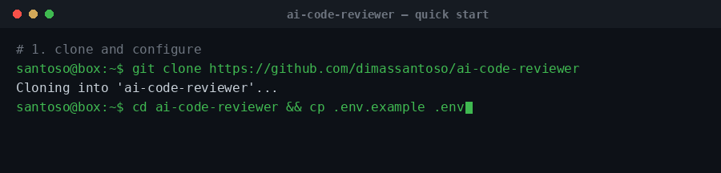

# ai-code-reviewer



Python stdlib webhook service for GitLab merge requests and GitHub pull requests. It fetches diffs, calls the Hermes Agent CLI, and posts review feedback. Hermes and a configured model provider are required; the server has no Python package dependencies.

Choose **Python direct** to use an existing host Hermes installation, or **Docker** to run the server with Hermes included in the image. Neither mode includes model credentials.

## Two ways to run

Docker — one command, no Python or Hermes install needed:

```bash
git clone https://github.com/dimassantoso/ai-code-reviewer && cd ai-code-reviewer
cp .env.example .env      # fill one token + its webhook secret
mkdir -p hermes-home && printf 'HERMES_UID=%s\nHERMES_GID=%s\n' "$(id -u)" "$(id -g)" >> .env
docker compose up -d --build
docker compose exec reviewer hermes setup   # provider login, once
curl -fsS http://127.0.0.1:9877/health
```

Python direct — requires Hermes already installed and authenticated:

```bash
git clone https://github.com/dimassantoso/ai-code-reviewer && cd ai-code-reviewer
cp .env.example .env      # fill one token + its webhook secret
set -a; . ./.env; set +a
python3 server.py
```

Point the platform webhook at `https://<host>/gl-review` or `https://<host>/gh-review`. Details for each mode below.


## Configuration

Copy `.env.example` to `.env` and fill in at least one platform token and its webhook secret. Protect this file and never commit it. Set up a dedicated Hermes home with a working provider and model; see the [Hermes documentation](https://hermes-agent.nousresearch.com/docs/).

| Variable | Meaning |
| --- | --- |
| `GITLAB_TOKEN`, `GITHUB_TOKEN` | API credentials; configure at least one. GitLab needs API access; GitHub needs repository pull request read/write access. |
| `GITLAB_WEBHOOK_SECRET`, `GITHUB_WEBHOOK_SECRET` | Required for each configured platform; `WEBHOOK_SECRET` is a shared fallback. Use separate random secrets. |
| `GITLAB_URL`, `GITHUB_URL` | HTTPS API base URLs; defaults are `https://gitlab.com` and `https://api.github.com`. For GitHub Enterprise include `/api/v3`. |
| `BIND_HOST`, `BIND_PORT` | Listen address and comma-separated ports; defaults `0.0.0.0` and `9877`. |
| `HERMES_BIN` | CLI executable; default `hermes` on PATH. |
| `HERMES_MODEL` | Optional model override; otherwise use Hermes configuration. |
| `HERMES_SKILL` | Optional skill name; example sets `ai-code-reviewer`. |
| `HERMES_TIMEOUT_S` | CLI timeout in seconds; default `300`. |
| `MAX_WORKERS` | Concurrent reviews; each one runs a `hermes` subprocess. Default `4`. |
| `QUEUE_SIZE` | Pending reviews held before new webhooks get `503`. Default `100`. |
| `BOT_USERNAME` | GitLab username to answer `@mention` debates. Blank disables debate replies. |
| `MIN_ACCESS_LEVEL` | GitLab access level required to review/reply. Default `30` (Developer). |
| `APPROVE_ACCESS_LEVEL` | Access level required for auto-approve. Default `40` (Maintainer). |
| `COOLDOWN_SECONDS` | Per-user per-thread debate cooldown. Default `30`. |
| `MAX_INLINE` | Inline comments posted per review. Default `20`. |
| `API_ATTEMPTS` | Tries per platform API call when the connection resets. Default `3`. HTTP errors are never retried. |
| `MAX_DEBATE_DIFF` | Diff characters handed to a debate reply. Default `20000`. |
| `DASHBOARD_USER`, `DASHBOARD_PASSWORD` | HTTP Basic auth for `/dashboard` and `/api/reviews`. Blank password leaves them open; the browser shows its own login prompt, so no token in the URL. |
| `REVIEW_STORE` | Optional JSONL path for review history. Unset keeps history in memory only (lost on restart). |
| `REVIEW_EST_S` | Expected review duration, used to scale the progress bar. Default `60`. |

The server reads environment variables, not `.env` itself. Docker Compose loads `.env` via `env_file`; direct Python users must export it. Use shell-compatible values if sourcing the file.

## Python direct

Install and configure [Hermes Agent](https://hermes-agent.nousresearch.com/docs/), including provider authentication. Install this checkout as a local skill in the dedicated Hermes home:

```bash
export HERMES_HOME="$HOME/.hermes-reviewer"
mkdir -p "$HERMES_HOME/skills/ai-code-reviewer"
cp SKILL.md "$HERMES_HOME/skills/ai-code-reviewer/"
cp -R github gitlab references templates "$HERMES_HOME/skills/ai-code-reviewer/"
hermes setup
hermes skills list
cp .env.example .env
# Edit .env privately.
set -a; . ./.env; set +a
python3 server.py
```

Keep `HERMES_HOME` set for both Hermes setup and server execution. Verify the provider and skill using the same CLI options as the service:

```bash
printf 'Review this harmless diff: + return 1' | hermes chat --query-file - -t "" -Q --max-turns 5 -s ai-code-reviewer
curl -fsS http://127.0.0.1:9877/health
```

## Docker Compose

The Dockerfile extends the official Hermes Agent image pinned by digest. It includes the real Hermes CLI and bundles this skill; the upstream startup hook syncs bundled skills into the persistent Hermes home. Keep the image entrypoint: it initializes the home and drops privileges.

```bash
cp .env.example .env
# Edit .env privately: platform token, webhook secret, HERMES_UID and HERMES_GID.
mkdir -p hermes-home
# Set HERMES_UID and HERMES_GID in .env to the output of id -u and id -g.
docker compose up -d --build
docker compose exec reviewer hermes setup
# Configure provider authentication for this dedicated Hermes home.
curl -fsS http://127.0.0.1:9877/health
docker compose logs -f reviewer
```

`./hermes-home` persists Hermes config, credentials, sessions and logs at `/opt/data`. Treat it as sensitive. Do **not** mount an active personal Hermes home: it can contain messaging credentials and gateway configuration that starts other services. A fresh home has no configured provider. Run a harmless diff through the exact CLI command above using `docker compose exec -T reviewer sh -c '...'` before enabling webhooks. `health` only proves the HTTP listener works.

Compose publishes only `127.0.0.1:9877` and forces the container listener to `0.0.0.0:9877`. Change the host side of `ports` if 9877 is occupied. For other container ports, update the port mapping and Docker healthcheck too. Use an HTTPS reverse proxy or tunnel to receive external webhooks; restrict access and retain signature verification.

## Webhooks and behavior

- GitLab: configure `https://<host>/gl-review` for merge request events. The server accepts `X-Gitlab-Token` or Standard Webhooks signing headers; `whsec_` secrets must contain valid base64.
- GitHub: configure `https://<host>/gh-review` for pull request events and JSON payloads. The server verifies `X-Hub-Signature-256`.
- `GET /health` returns `200 ok`. A disabled platform returns `404`; an invalid signature returns `403`.
- Webhooks that cannot produce a review — `Push Hook`, MR `close`/`merge`/label events, unrelated CI hooks — return `200 ignored` and are never recorded on the dashboard. Only real reviews and debate replies create a row.
- `GET /dashboard` is a live review dashboard; `GET /api/reviews` is the same data as JSON. Both are read-only and ask for HTTP Basic login when `DASHBOARD_PASSWORD` is set.
- Valid requests are acknowledged with `202 accepted` before background processing. This is not proof a review was posted; inspect logs and the MR/PR. Duplicate payloads are suppressed in memory for five minutes, not durably across restarts.
- GitLab open/update/reopen and GitHub opened/synchronize/reopened events trigger review. Both platforms get inline comments on lines that exist in the diff (GitLab as discussions, GitHub as a batched review) plus a summary; `MAX_INLINE` caps them per review (default 20).
- Auto-approve: verdict `APPROVE`, target is not a draft, and the token user may approve. GitLab additionally requires access ≥ `APPROVE_ACCESS_LEVEL` and checks `user_can_approve`; GitHub requires push permission on the repo.
- A review whose head commit moved while the model was thinking is discarded, so a stale verdict never lands on newer code.
- A target whose head SHA was already reviewed is skipped. This is what stops the approve -> update event -> approve loop: our own approval fires a fresh MR event with identical code. Push a new commit and the head changes, so it is reviewed again. The memory is in-process (cleared on restart).
- Debate: a GitLab note or GitHub comment that `@BOT_USERNAME` and is not our own reply gets an in-thread answer. Per-note dedupe, per-thread cooldown (`COOLDOWN_SECONDS`), a bounded transcript of that discussion, and the diff under discussion (up to `MAX_DEBATE_DIFF`); GitLab additionally requires `MIN_ACCESS_LEVEL`. Bot and `[bot]` authors are ignored. Blank `BOT_USERNAME` disables it.
- A dropped connection (`Connection reset by peer`) during a platform API call is retried up to `API_ATTEMPTS` times with a short backoff instead of failing the review. HTTP errors (401/404) are not retried.
- Diffs larger than `MAX_DIFF` (100,000 characters) are reviewed in chunks — several model calls over file and hunk boundaries, merged with the strictest verdict — instead of being rejected or truncated. API and Hermes errors are logged; retries and persistence are not guaranteed after acknowledgement.

Review input is untrusted. The service requests empty Hermes toolsets and strips platform credentials from the CLI child environment, but use a dedicated least-privilege account and review model output before acting on it.

## Tests

```bash
python3 -m unittest discover -s tests -v   # 38 tests: units, end-to-end, concurrency races
python3 tests/loadtest.py --requests 200 --concurrency 32 --workers 4
```

Tests use mocks and do not prove platform credentials, network access or model readiness.

## Operating it

`make` lists every target. The ones you will actually use on the box:

```
make restart     # after editing .env or pulling code
make health      # 200 check against the MagicDNS name
make dash        # dashboard URL + where the password lives
make log         # last 100 lines of server.log
make logs        # stream server.log
make password NEW=secret   # rewrite DASHBOARD_PASSWORD and restart
make deploy      # git pull origin/master, restart, health check
```

`make` resolves the host from `tailscale status` (MagicDNS name), so the printed URL keeps working when the tailnet IP changes.

## Dashboard and access

`GET /dashboard` shows live reviews (stage, elapsed, progress), totals, average and p95 duration, verdict counts and history. `GET /api/reviews` is the same data as JSON.

Access is HTTP Basic when `DASHBOARD_PASSWORD` is set — the browser's own login prompt, no token in the URL, nothing to leak in bookmarks or referrers. Blank password leaves it open, which is only acceptable when a proxy does the gating.

Three ways to expose it, pick one:

- **Tailscale (simplest).** Bind to the tailnet and skip app auth: `BIND_HOST=<tailscale-ip>`. Only devices on the tailnet can reach the port.
- **Cloudflare Zero Trust.** Point an Access application at the dashboard hostname, add an allow policy for your email/IdP, then leave `DASHBOARD_PASSWORD` blank — Access authenticates before the request reaches the server. Keep the webhook path (`/gl-review`, `/gh-review`) outside the Access policy or use a service token, otherwise webhooks get redirected to a login page.
- **Plain LAN + Basic auth.** Set `DASHBOARD_PASSWORD` and accept that Basic credentials are only as private as the network.

Never put the dashboard behind a path that also serves webhooks without checking that policy bypass — a 302 to a login page reads as a delivery failure on GitLab.

## Concurrency and limits

- Reviews run in a fixed worker pool (`MAX_WORKERS`); webhooks queue up to `QUEUE_SIZE` then get `503` so the platform retries. Ack is immediate (`202`) — a full queue is the only throttle.
- Two events for the same MR/PR are serialized by a per-target lock, so an older diff cannot post its review after a newer one.
- Duplicate payloads are claimed under a lock before dispatch: 16 parallel copies of one delivery produce exactly one review.
- A failed review releases its claim, so the platform's retry is not swallowed by dedupe.
- Accept backlog is 128 (stdlib default 5 drops connections under a burst).

Measured on an ARM SBC (4×A55, Python 3.13, stub review of 50 ms): ~43 webhook req/s ack throughput, p50 37 ms at concurrency 1; `/health` ceiling ~170 req/s. Real throughput is bounded by `MAX_WORKERS / review_latency`, not by the HTTP layer — a 20 s model review with 4 workers means ~0.2 reviews/s.

`tests/loadtest.py` verifies the pool never exceeds `MAX_WORKERS` and reports statuses, throughput and latency percentiles.
