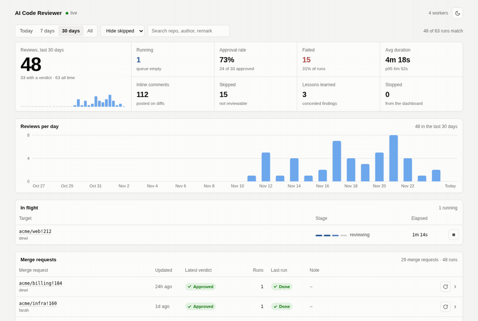
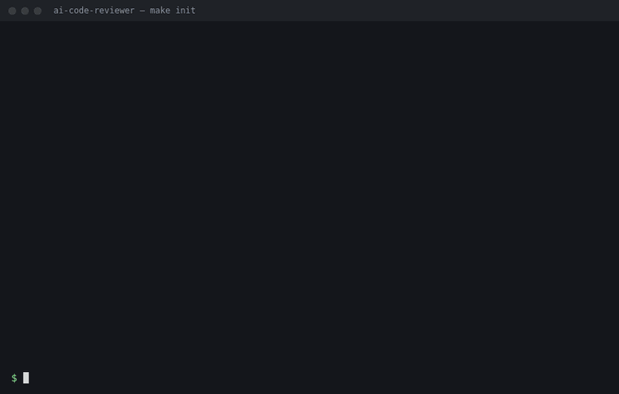

# ai-code-reviewer

An AI reviewer for GitLab merge requests and GitHub pull requests. It reviews when someone asks, posts inline findings and a summary, approves clean changes, answers replies in its threads, and learns from the findings it got wrong.



- **One small service.** `server.py` is Python standard library only. The model runs through the [Hermes Agent](https://hermes-agent.nousresearch.com/docs/) CLI, so any provider Hermes supports works.
- **Reviews on request, not on every push.** Opening an MR, marking it ready, adding the bot as reviewer, or commenting `@bot review`.
- **A consistent second pass.** A re-review sees its own open findings, drops the fixed ones, resolves their threads and withdraws an approval when it now requests changes.
- **It argues fairly.** Replies to its comments get a decision first (answer, defend, concede, or stay quiet). Conceded findings are stored and fed into later reviews of the same repo.
- **A live dashboard** with one row per merge request, a timeline per merge request, and stop / re-review / delete actions.

## Quick start



```bash
git clone https://github.com/dimassantoso/ai-code-reviewer && cd ai-code-reviewer
make init        # asks for the platform token, webhook secret, model and dashboard login, writes .env
```

`make init` checks the token against the platform API, generates the webhook secret and dashboard password, finds `hermes`, can run one harmless review to prove the model answers, and offers to install the review skill and a systemd user service. Run it again any time; the current values are the defaults. `python3 tools/init.py --yes` runs it without questions.

Then start the server one of two ways.

**Docker** (Hermes is included in the image):

```bash
mkdir -p hermes-home && printf 'HERMES_UID=%s\nHERMES_GID=%s\n' "$(id -u)" "$(id -g)" >> .env
docker compose up -d --build
docker compose exec reviewer hermes setup     # provider login, once
curl -fsS http://127.0.0.1:9877/health
```

**Python** (Hermes already installed and logged in on the host):

```bash
set -a; . ./.env; set +a
python3 server.py
```

Finally, connect a repository:

```bash
make add REPO=group/project        # GitLab
make add REPO=owner/repo           # GitHub
```

`make add` creates (or updates) the webhook at `$PUBLIC_URL/gl-review` or `$PUBLIC_URL/gh-review`. Open `http://<host>:9877/dashboard` and open a merge request to see the first review.

## When a review runs

Only when someone asks for one.

| Request | GitLab | GitHub |
| --- | --- | --- |
| A new MR / PR | opened (drafts wait) | opened (drafts wait) |
| A draft is ready | marked ready | ready for review |
| Ask the bot | add it as a reviewer | request its review, or press **Re-request review** |
| Ask in a comment | `@bot review` | `@bot review` |
| From the dashboard | **Re-review** button | **Re-review** button |

The comment command also accepts `re-review` and `recheck`, with or without "please" or "can you". The bot reacts 👀 so the requester knows it was picked up.

**Pushing commits never starts a review**, and neither do title, label or description edits or a reopen. GitLab sends no reliable event for its own "re-request review" button, so on GitLab use the comment, or remove the bot as reviewer and add it again. `BOT_USERNAME` must be the token account's username for reviewer requests to match.

What a review posts:

- Inline comments on lines in the diff, grouped as 🔴 Critical, ⚠️ Warning and 💡 Suggestion, each with a concrete fix (at most `MAX_INLINE`, default 20).
- A summary comment and a verdict. `APPROVE` approves the MR when the token account is allowed to; `REQUEST_CHANGES` withdraws the bot's earlier approval.
- On a re-review, threads for findings that are now fixed are resolved. Only the bot's own threads are closed, and never one a person has replied in.

Big diffs are split into parts (`MAX_DIFF` characters each) and reviewed within `REVIEW_BUDGET_S`; the strictest verdict wins, and parts that were not reached are named in the summary. A result is thrown away if the MR moved to a newer commit while the model was thinking.

## Talking to the bot

Reply in one of the bot's threads, or mention `@bot` anywhere on the MR. Before anything is posted, one model call picks a stance:

| Stance | When | What happens |
| --- | --- | --- |
| `NO_REPLY` | "thanks", "fixed", off-topic | nothing is posted |
| `ANSWER` | a question | a short explanation |
| `DEFEND` | pushback without a good reason | the point, once, with evidence |
| `CONCEDE` | pushback with a sound reason | "You're right …", the thread is resolved, and the finding is saved as a lesson |

Lessons live in `MEMORY_DB` (SQLite). The latest `LESSONS_IN_PROMPT` for a repo go into every later review of that repo, so the same false positive is not raised again. `make mistakes` lists them. On GitHub the concession is saved but the thread stays open, because GitHub has no REST call to resolve it.

Cheap checks run before the model: the bot ignores its own comments, other bots, users below `MIN_ACCESS_LEVEL` (GitLab) and repeat comments within `COOLDOWN_SECONDS`.

## Dashboard

`/dashboard` updates live over Server-Sent Events. It has a light and a dark theme.

- **Overview:** reviews in the selected range, approval rate, failures, average and p95 duration, inline comments, lessons learned, a reviews-per-day chart and the reviews running now.
- **Merge requests:** one row per MR/PR with its latest verdict, run count and last run. Filter by range, status (skipped runs are hidden by default) or text.
- **Detail page:** click a row for that MR's timeline: every run with its verdict, files, inline comments, duration and error, newest first.

Actions:

- **Stop** a running review. The model process is killed and nothing more is posted.
- **Re-review** an MR. Queues a fresh review that carries the bot's open findings. Merged or closed MRs are refused.
- **Delete** one run from the timeline. It is removed from `REVIEW_STORE` too.

Actions need the dashboard login and an `X-Dashboard: 1` header, and cross-site requests are refused. Scripts can call `POST /api/reviews/<id>/stop|rereview|delete`. `GET /api/reviews` returns the whole snapshot as JSON.

## Configuration

`make init` writes all of this to `.env` (mode 600, the old file backed up). To do it by hand, copy `.env.example`. The server reads the environment, not `.env` itself: Docker Compose loads it through `env_file`, and a direct run must export it.

| Variable | Meaning |
| --- | --- |
| `GITLAB_TOKEN`, `GITHUB_TOKEN` | API tokens; set at least one. GitLab needs API scope; GitHub needs pull request read/write. |
| `GITLAB_WEBHOOK_SECRET`, `GITHUB_WEBHOOK_SECRET` | Required for each platform you use. `WEBHOOK_SECRET` is a shared fallback. |
| `GITLAB_URL`, `GITHUB_URL` | API base URLs. Defaults `https://gitlab.com` and `https://api.github.com`; GitHub Enterprise adds `/api/v3`. |
| `PUBLIC_URL` | The public base URL the platforms call; used by `make add`. |
| `BIND_HOST`, `BIND_PORT` | Listen address and comma-separated ports. Defaults `0.0.0.0` and `9877`. |
| `BOT_USERNAME` | The token account's username. Needed for reviewer requests, `@bot review` and replies; blank turns replies off. |
| `HERMES_BIN`, `HERMES_PROFILE`, `HERMES_MODEL` | The CLI, an optional profile (`-p`) and an optional model override. |
| `HERMES_SKILL` | The review skill loaded into every call. Default `ai-code-reviewer`. |
| `HERMES_TIMEOUT_S` | Timeout for one model call. Default `300`. |
| `MAX_DIFF` | Diff characters per model call; larger diffs are split. Default `30000`. |
| `REVIEW_BUDGET_S` | Time budget for all calls of one review. Default `1200`. |
| `MAX_INLINE` | Inline comments per review. Default `20`. |
| `REVIEW_REPOS` | Comma-separated allowlist of `group/project` or `owner/repo`. Empty allows every repo that sends a hook. |
| `MIN_ACCESS_LEVEL`, `APPROVE_ACCESS_LEVEL` | GitLab access needed to review or reply (default `30`, Developer) and to approve (default `40`, Maintainer). |
| `COOLDOWN_SECONDS` | Per-user, per-thread reply cooldown. Default `30`. |
| `MAX_WORKERS`, `QUEUE_SIZE` | Concurrent reviews (default `4`) and queued reviews before webhooks get `503` (default `100`). |
| `API_ATTEMPTS` | Tries per platform call when the connection drops. Default `3`; HTTP errors are never retried. |
| `DASHBOARD_USER`, `DASHBOARD_PASSWORD` | HTTP Basic login for the dashboard and its API. A blank password leaves them open. |
| `REVIEW_STORE` | JSONL file for review history. Unset keeps history in memory only. |
| `MEMORY_DB`, `LESSONS_IN_PROMPT` | SQLite file for conceded findings (blank turns learning off) and how many go into each prompt (default `10`). |

## The review skill

`SKILL.md` is the rubric and output format loaded into every model call: what the model can see, how to work through a diff, the seven review gates, domain checks (money, personal data, migrations, infrastructure, shell, dependencies), checks per language, severity calibration with examples, the verdict rules and the reply rules. Edit it in this repo and install it with `make skill`, which copies it into the Hermes home (`HERMES_HOME`, `HERMES_PROFILE`) and keeps a `.bak` of the previous one. The change applies to the next review without a restart. Don't edit the installed copy; the next `make deploy` overwrites it.

## Running it on a server

```bash
make status | restart | health | log | logs   # the systemd user service
make dash                                     # dashboard URL and where the password lives
make password NEW=secret                      # change the dashboard password and restart
make skill                                    # install SKILL.md into the Hermes home
make mistakes                                 # lessons learned, newest first (N=20)
make reset                                    # wipe review history (asks first, keeps a backup)
make deploy                                   # git reset --hard origin/master, install the skill, restart
```

`make deploy` throws away local changes in the checkout, so commit first.

**Docker notes.** The image extends the official Hermes Agent image, pinned by digest, and bundles `SKILL.md`. `./hermes-home` holds the Hermes config and provider credentials at `/opt/data`; treat it as a secret, and never mount your personal Hermes home. Compose publishes only `127.0.0.1:9877`, so put an HTTPS proxy or tunnel in front for webhooks.

**Exposing the dashboard.** Pick one:

- **Tailscale.** `BIND_HOST=<tailscale-ip>`; only your tailnet can reach it.
- **Cloudflare Zero Trust.** An Access policy on the dashboard host, `DASHBOARD_PASSWORD` blank. Keep `/gl-review` and `/gh-review` outside the policy, or webhooks are redirected to a login page.
- **Basic auth on a private network.** Set `DASHBOARD_PASSWORD`.

## How it works

1. A webhook arrives at `/gl-review` or `/gh-review`. The signature is checked: the GitLab token or Standard Webhooks for GitLab, `X-Hub-Signature-256` for GitHub.
2. Anything that is not a review request returns `200 ignored` and creates no dashboard row. Duplicate deliveries are dropped.
3. The job joins a bounded queue and the webhook gets `202` at once, because platforms time webhooks out at 10 s.
4. A worker fetches the diff, builds the prompt (diff, open findings, lessons) and runs `hermes chat` with no tools. Platform tokens are stripped from its environment.
5. The output is parsed into inline comments, a summary and a verdict, and posted. Events for the same MR run one at a time.

Review input is untrusted. Use a dedicated, least-privilege bot account, and read what the model posts before acting on it.

**Limits.** Throughput is `MAX_WORKERS / review time`: 4 workers and 2-minute reviews give about 2 reviews a minute. The HTTP layer is not the bottleneck: about 40 webhooks a second on a 4-core ARM board. Dedupe, the reviewed-head memory and queued jobs live in memory and are lost on restart; review history and lessons persist.

## Development

```bash
make test                                                    # full unit and end-to-end suite
python3 -m unittest tests.test_server.ReviewRequestTests -v  # one class
python3 tests/loadtest.py --requests 200 --concurrency 32 --workers 4
```

The tests use a fake GitLab and a stub `hermes`. They don't prove that your tokens, network or model work; `make init` and `make health` do that.
